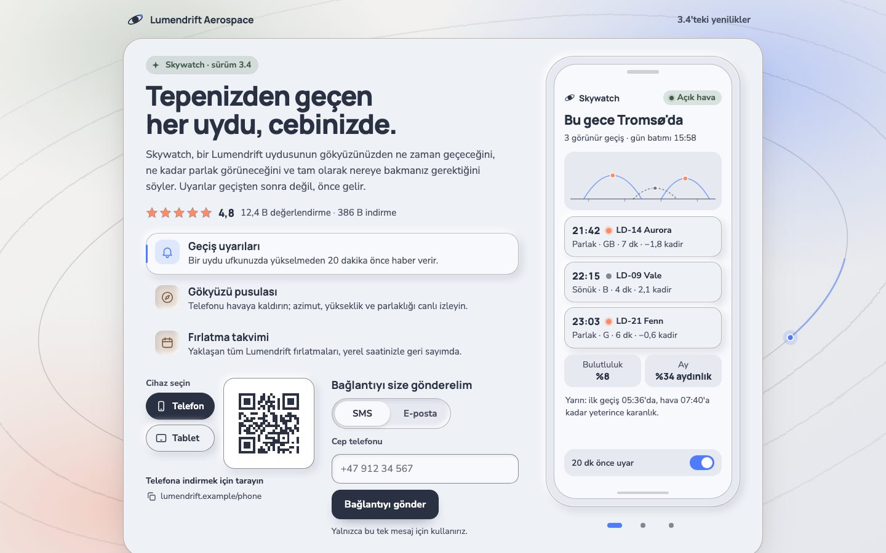
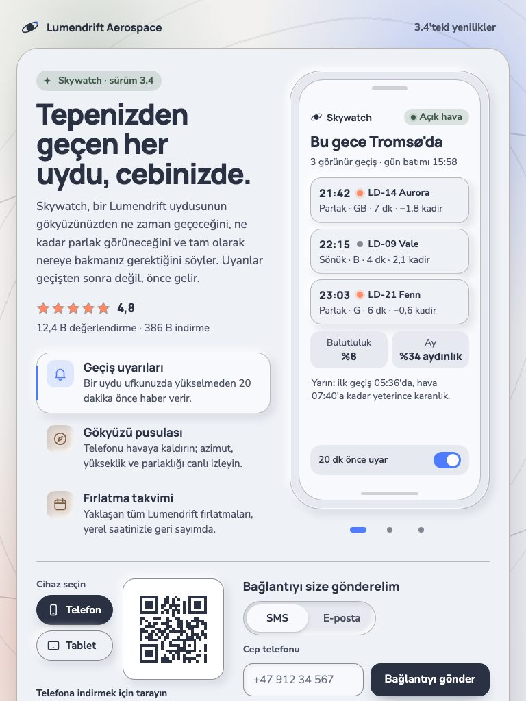
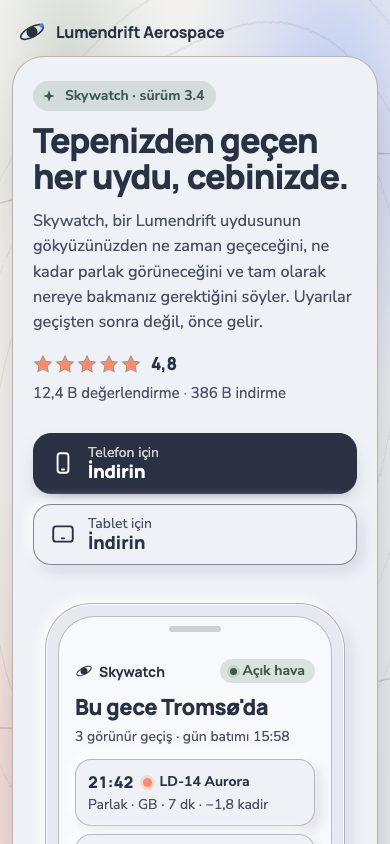
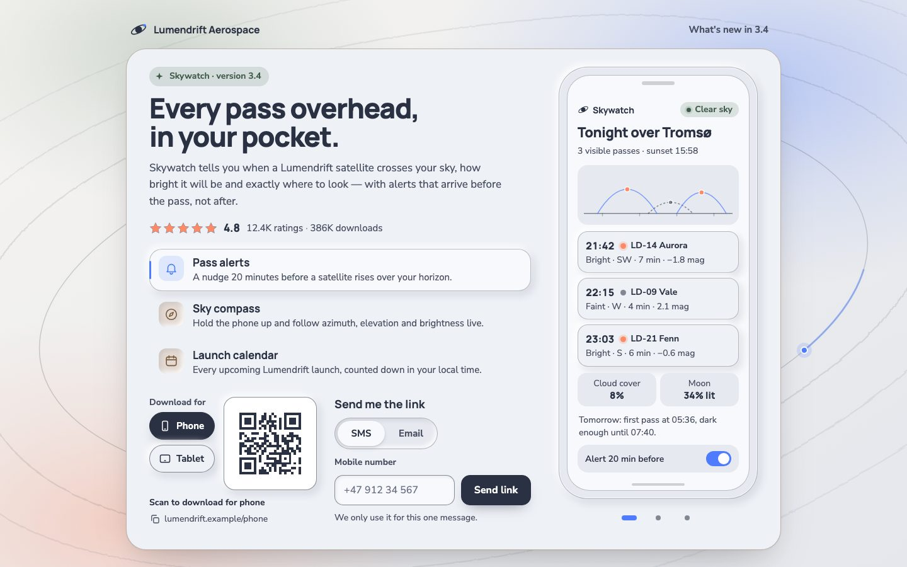
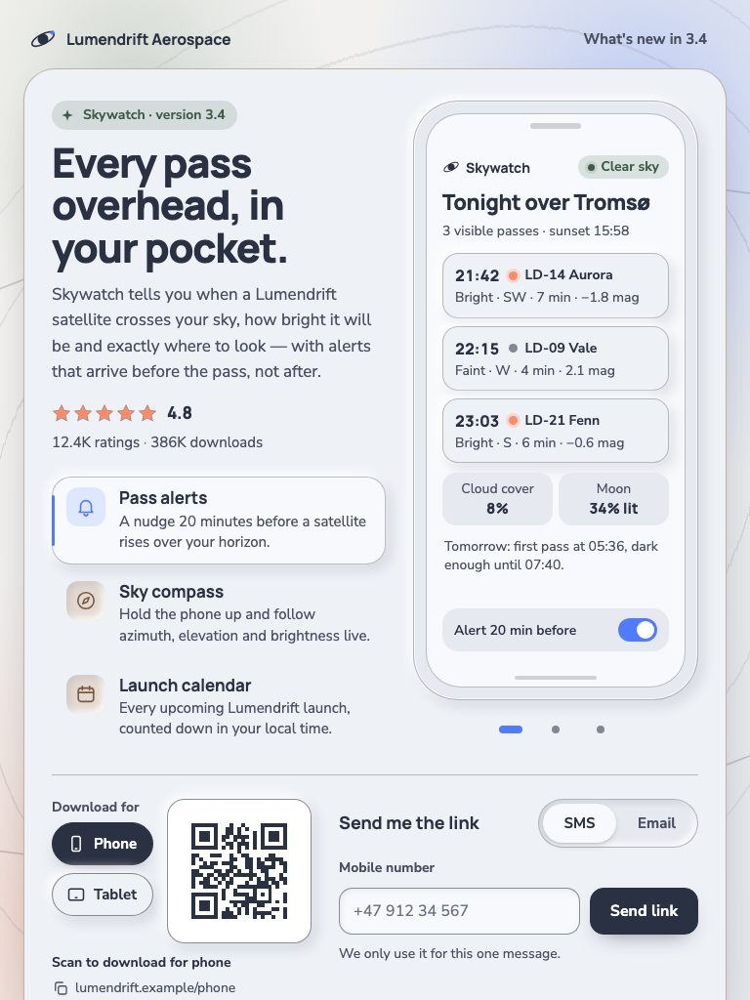
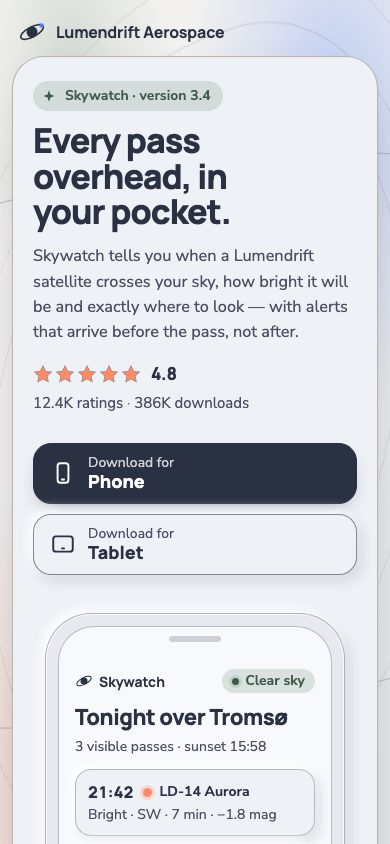

Türkçe · [English](#english)

# Sakin Yörünge Uygulama Tanıtım Kartı

Kurgusal bir uydu gözlem uygulaması için ahşap ve adaçayı tonlu, İskandinav sadeliğinde bir "uygulamayı indirin" kartı. CSS telefon, üzerine gelinen avantajı izleyen üç ekranlı bir karusel taşıyor; saf JavaScript ile üretilen canlı QR kod, Telefon ve Tablet arasında geçince yeniden çiziliyor. SMS/E-posta seçimli form girdiyi doğruluyor, gönderiyor ve maskeli hedefle onaylıyor. Telefonlarda QR yerine doğrudan indirme düğmeleri çıkıyor. Arkada SVG sıvı gürültüsünden bir gökyüzü nefes alıyor, bir uydu yörüngesinde süzülüyor.

**Canlı demo:** [Türkçe](https://exodus-ui-lab.github.io/quiet-orbit-app-promo-card/) · [English](https://exodus-ui-lab.github.io/quiet-orbit-app-promo-card/en/)



| Tablet — 768 px | Mobil — 390 px |
|:---:|:---:|
|  |  |

## Öne çıkanlar

- Üzerine gelinen avantaja kayan telefon ekranı
- Tarayıcıda kodlanan, tarama efektiyle yeniden çizilen QR kod
- Ahşap ve adaçayı vurgulu yumuşak neumorfik yüzeyler
- SVG türbülans ve yer değiştirmeyle sıvı gürültülü gökyüzü
- Kartı yerinde tutan maskeli SMS veya e-posta onayı

## İçerik

| Klasör | Ne var |
|---|---|
| `frontend/` | Bölümün İngilizce hâli: sade HTML, CSS ve JavaScript, derleme adımı yok |
| `frontend-tr/` | Aynı bölümün Türkçe hâli (kod aynı, metinler çevrildi) |
| `backend/` | Bölümün çağırdığı API: Node.js + Fastify, testleriyle birlikte |
| `docs/` | Canlı demo sitesi (GitHub Pages): Türkçesi kökte, İngilizcesi `en/` altında; API örnek yanıtlarla cevaplanır |

## Yerelde çalıştırma

### Frontend

Örnek API yanıtlarıyla demo için `docs/` klasörünü, gerçek yanıtlar için `frontend-tr/` klasörünü sunup aşağıdaki backend’i çalıştırın:

```bash
npx serve docs         # örnek yanıtlarla demo
npx serve frontend-tr  # arayüz; canlı veri için backend’i başlatın
```

### Backend

```bash
cd backend
npm install
npm test
npm start
```

Ayarlar ve ayrıntılar: [backend/README.md](backend/README.md).

## API

Bölümün kullandığı uç noktalar (demodaki örnek yanıtlar):

### `GET /api/app`

Örnek yanıt (`200`):

```json
{
  "app": {
    "name": "Skywatch",
    "version": "3.4.1"
  },
  "rating": {
    "average": 4.8,
    "count": 12400
  },
  "downloads": 386000,
  "screens": [
    {
      "id": "alerts",
      "title": "Geçiş uyarıları"
    },
    {
      "id": "compass",
      "title": "Gökyüzü pusulası"
    }
  ],
  "links": {
    "phone": "https://lumendrift.example/phone",
    "tablet": "https://lumendrift.example/tablet"
  }
}
```

### `POST /api/app-link`

Örnek yanıt (`200`):

```json
{
  "ok": true,
  "channel": "sms",
  "platform": "tablet",
  "maskedDestination": "+47 ••• •• 532",
  "message": "Ulaşması bir dakikayı bulabilir."
}
```

_Uzun listeler ve metinler burada kısaltıldı._

Sözleşmenin tamamı: [backend/CONTRACT.md](backend/CONTRACT.md).

## Lisans

MIT © 2026 Exodus Yazılım. Ayrıntılar için [LICENSE](LICENSE).

"Lumendrift Aerospace" hayali bir markadır; demodaki tüm isimler, şirketler ve alıntılar kurgudur.

---

## English

### Quiet Orbit App Promo Card

A Scandinavian-light 'get the app' card for a fictional satellite-watching app, warmed with wood and sage accents. A generic CSS phone carries a three-screen HTML carousel that follows the benefit you hover; a live QR code is generated in plain JavaScript and redraws when you switch between Phone and Tablet right beside it; a send-me-the-link form with an SMS/Email switch validates, posts and confirms with a masked destination. On phones the QR gives way to direct download buttons. Behind it, an SVG liquid-noise sky breathes and a satellite with a short trail drifts along an orbit ring.

**Live demo:** [English](https://exodus-ui-lab.github.io/quiet-orbit-app-promo-card/en/) · [Türkçe](https://exodus-ui-lab.github.io/quiet-orbit-app-promo-card/)



| Tablet — 768 px | Mobile — 390 px |
|:---:|:---:|
|  |  |

#### Highlights

- Phone screen that slides to whichever benefit you hover
- QR code encoded in the browser and redrawn with a scan sweep
- Soft neumorphic surfaces with wood and sage accents
- Liquid-noise sky from SVG turbulence and displacement
- Masked SMS or email confirmation that keeps the card still

#### What's inside

| Folder | Contents |
|---|---|
| `frontend/` | The section in English: vanilla HTML, CSS and JavaScript, no build step |
| `frontend-tr/` | The same section in Turkish (identical code, translated copy) |
| `backend/` | The API the section calls: Node.js + Fastify, with tests |
| `docs/` | The live demo site (GitHub Pages): Turkish at the root, English under `en/`; the API is answered from example responses |

#### Run it locally

##### Frontend

Serve `docs/` for the demo with example API responses, or serve `frontend/` and run the backend below for real ones:

```bash
npx serve docs      # demo with example responses (English under /en/)
npx serve frontend  # the UI; start the backend for live data
```

##### Backend

```bash
cd backend
npm install
npm test
npm start
```

Configuration and details: [backend/README.md](backend/README.md).

#### API

The section talks to these endpoints (example responses from the demo):

##### `GET /api/app`

Example response (`200`):

```json
{
  "app": {
    "name": "Skywatch",
    "version": "3.4.1"
  },
  "rating": {
    "average": 4.8,
    "count": 12400
  },
  "downloads": 386000,
  "screens": [
    {
      "id": "alerts",
      "title": "Pass alerts"
    },
    {
      "id": "compass",
      "title": "Sky compass"
    }
  ],
  "links": {
    "phone": "https://lumendrift.example/phone",
    "tablet": "https://lumendrift.example/tablet"
  }
}
```

##### `POST /api/app-link`

Example response (`200`):

```json
{
  "ok": true,
  "channel": "sms",
  "platform": "tablet",
  "maskedDestination": "+47 ••• •• 532",
  "message": "It can take up to a minute to arrive."
}
```

_Long lists and strings are shortened here._

Full contract: [backend/CONTRACT.md](backend/CONTRACT.md).

#### License

MIT © 2026 Exodus Yazılım. See [LICENSE](LICENSE).

"Lumendrift Aerospace" is a fictional brand; every name, company and quote in the demo is made up.

---

[Exodus Yazılım](https://exodusyazilim.com)
